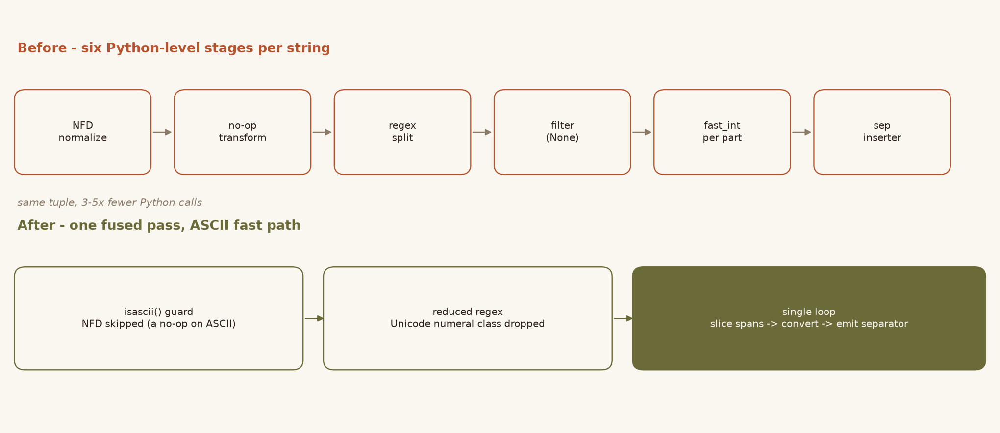
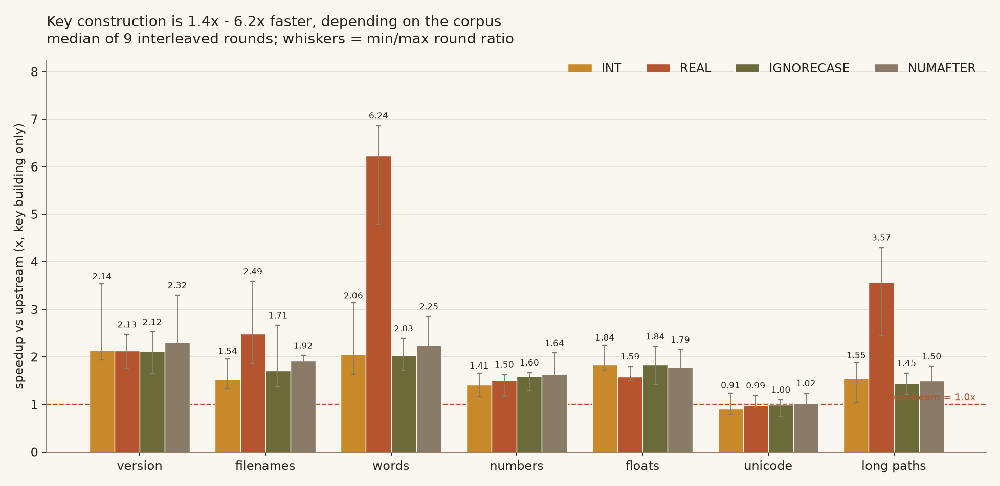
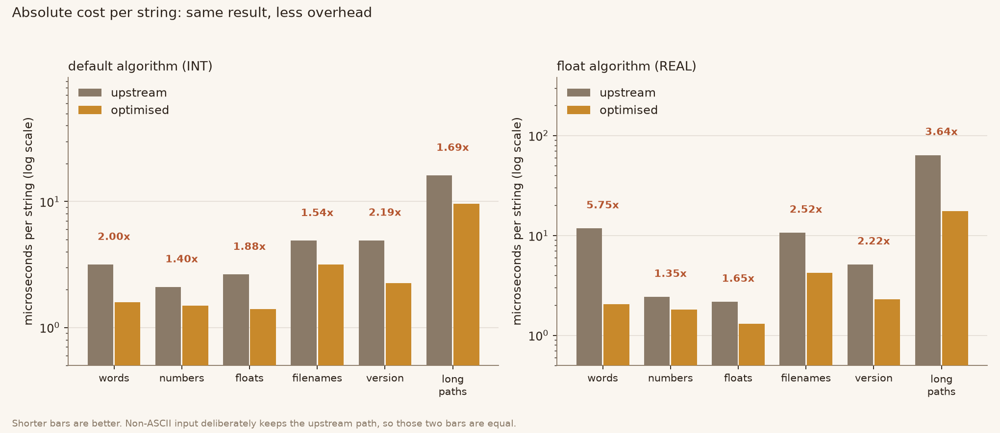
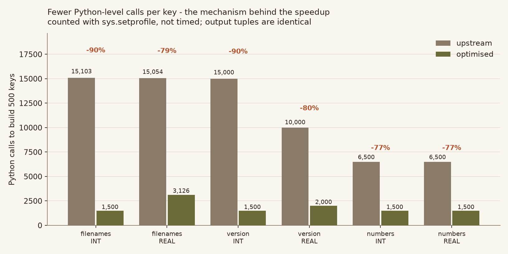

natsort
=======

.. image:: https://img.shields.io/pypi/v/natsort.svg
    :target: https://pypi.org/project/natsort/

.. image:: https://img.shields.io/pypi/pyversions/natsort.svg
    :target: https://pypi.org/project/natsort/

.. image:: https://img.shields.io/pypi/l/natsort.svg
    :target: https://github.com/SethMMorton/natsort/blob/main/LICENSE

.. image:: https://github.com/SethMMorton/natsort/workflows/Tests/badge.svg
    :target: https://github.com/SethMMorton/natsort/actions

.. image:: https://codecov.io/gh/SethMMorton/natsort/branch/main/graph/badge.svg
    :target: https://codecov.io/gh/SethMMorton/natsort

.. image:: https://img.shields.io/pypi/dw/natsort.svg
    :target: https://pypi.org/project/natsort/

Simple yet flexible natural sorting in Python.

    - Source Code: https://github.com/SethMMorton/natsort
    - Downloads: https://pypi.org/project/natsort/
    - Documentation: https://natsort.readthedocs.io/

      - `Examples and Recipes`_
      - `How Does Natsort Work?`_
      - `API`_

    - `Quick Description`_
    - `Quick Examples`_
    - `FAQ`_
    - `Feature Requests`_
    - `Requirements`_
    - `Optional Dependencies`_
    - `Installation`_
    - `How to Run Tests`_
    - `How to Build Documentation`_
    - `Dropped Deprecated APIs`_
    - `History`_

**NOTE**: Please see the `Dropped Deprecated APIs`_ section for changes.

Performance fork: fused ASCII key builder
-----------------------------------------

This repository is a fork of `natsort`_ whose only behavioural difference is
that the default key builder is faster. The produced keys are identical; the
work to produce them is not. Everything below is measured on the code in
``natsort/``, with the harness in ``bench/`` and the raw numbers in
``bench/results/``.

**What was slow.** Building one key for the default algorithm passed the string
through six Python-level stages - ``unicodedata.normalize``, a no-op transform,
``re.split``, ``filter(None, ...)``, a generator chain that called
``fast_int``/``fast_float`` once per component, and a generator that re-inserted
separators. Profiling showed that these stages, not the numeric conversion or
the regex itself, dominated the time: 66-88% of ``natsorted()`` was spent
building keys.

**What changed.** ``natsort.utils.fast_string_parser_factory`` performs the same
work in a single pass, and is selected by ``natsort_keygen`` when (and only
when) it is provably equivalent:

* ASCII input skips ``unicodedata.normalize("NFD", ...)``, which is a no-op on
  ASCII and the single most expensive call per short string.
* The numeric pattern is reduced to its ASCII-only form. Upstream patterns end
  in an alternative that matches a single Unicode numeral
  (``(\\d+|[²³¹ኩ…])``); an ASCII string cannot contain such a character, so the
  alternative is dead weight for every ASCII input. The reduced pattern is
  *derived from* ``regex_chooser`` output - the numeric body is kept verbatim -
  so it cannot drift from the slow path.
* Components are sliced out of the matched spans, so no empty strings are ever
  created and ``filter(None, ...)`` disappears.
* The separator is appended inline, replacing the ``sep_inserter`` generator.
* A component is only handed to ``int``/``float`` when it can actually be a
  number. On the float path, ``nan``/``inf``/``infinity`` are still recognised,
  and NaN still maps to the NANLAST sentinel.

Anything the fusion does not model - non-ASCII input, ``LOCALE``,
``GROUPLETTERS``, ``PATH``, ``LOWERCASEFIRST`` - is routed to the original
pipeline unchanged. That is why the non-ASCII corpus shows no speedup: it is
deliberately not optimised rather than optimised approximately.

Results
+++++++

Keys are 1.4x to 6.2x faster to build, depending on the corpus (non-ASCII
input is unchanged by design and excluded from that range):

Because key building is 66-88% of a sort, end-to-end ``natsorted()`` speedups
are lower - 1.3x to 5.5x on 5000-element lists - and that is the number users
feel:

The mechanism is counted, not inferred. On the same 500 inputs the optimised
builder makes 77-90% fewer Python-level calls, while producing identical
tuples:

End-to-end ``natsorted`` on 5000 items, median of 9 interleaved rounds:

.. list-table::
    :header-rows: 1

    * - Corpus
      - Algorithm
      - upstream
      - optimised
      - Speedup
    * - filenames
      - default
      - 30.6 ms
      - 18.0 ms
      - 1.54x
    * - filenames
      - ``ns.REAL``
      - 58.8 ms
      - 22.6 ms
      - 2.60x
    * - version strings
      - default
      - 29.6 ms
      - 19.1 ms
      - 1.78x
    * - words, no digits
      - ``ns.REAL``
      - 48.5 ms
      - 8.8 ms
      - 5.52x
    * - long paths
      - ``ns.REAL``
      - 30.8 ms
      - 9.0 ms
      - 3.37x
    * - integers only
      - default
      - 11.9 ms
      - 9.6 ms
      - 1.31x
    * - non-ASCII (unchanged path)
      - default
      - 27.4 ms
      - 31.4 ms
      - 0.93x (noise)

Which part pays
+++++++++++++++

``bench/ablate.py`` builds three variants that differ by exactly one mechanism
and times them against upstream, all wrapped in the same ``natsort_key``
dispatch so every arm pays the same per-call overhead:

.. list-table::
    :header-rows: 1

    * - Step
      - What it isolates
      - Effect
    * - upstream -> fused loop, NFD still applied
      - removing the six stages (split/filter/generators/per-part conversion)
      - 1.75x
    * - then skip NFD on ASCII
      - ``unicodedata.normalize`` on input that cannot be affected by it
      - +1.14x
    * - then reduce the regex to ASCII
      - the Unicode numeral alternative, dead for ASCII input
      - +1.13x

The shipped code matches the third variant (ratio 0.99, i.e. no measurable
difference), so nothing beyond those three mechanisms is contributing - and
nothing was lost in transcription from the experiment to the library.

**Correctness.** The upstream suite passes unchanged (363 tests, plus README
and ``docs/examples.rst`` doctests), and 52 added tests in
``tests/test_fast_parser.py`` cover the fused parser specifically - including
structural checks that it is actually selected, that the reduced pattern is
really reduced, and that non-ASCII input still reaches the original pipeline.
``bench/diff_test.py`` compares both implementations over 72,789 cases: 19 flag
combinations against hand-picked edge cases (``""``, ``"nan"``, ``"1_2"``,
``"１２３"``, ``"²"``, ``"\x00"``, combining accents, lone signs,
whitespace-padded numbers, ``Path`` objects, ``bytes``, ``None``) and generated
short strings, comparing both the value *and* the type of every component.
``--poison`` breaks one rule on purpose and asserts the harness notices, so a
green run means something.

**Methodology.** ``bench/harness.py`` measures with interleaved A/B rounds and
per-round ratios, each arm calibrated to the same wall time. An A/A control
(two byte-identical trees) puts the noise floor at a median ratio of 1.0013,
range 0.93-1.10 - which is why the non-ASCII row above is reported as noise
rather than as a regression.

Reproduce
+++++++++

.. code-block:: console

    python -m venv .venv && . .venv/bin/activate
    pip install pytest pytest-mock hypothesis
    pip install -e .

    python -m pytest tests -q                 # 415 passed
    python bench/diff_test.py                 # needs the reference arm, see below
    python bench/diff_test.py --poison        # the harness must detect the bug
    python bench/aa_control.py                # noise floor, ~1.0x
    python bench/bench_key.py                 # -> bench/results/bench_key.json
    python bench/bench_e2e.py                 # -> bench/results/bench_e2e.json
    python bench/count_work.py                # -> bench/results/work_count.json
    python bench/ablate.py                    # -> bench/results/ablation.json
    python assets/make_figures.py             # figures from those JSON files

The comparison scripts need two arms: ``self`` (this repository) and
``upstream`` (the pristine implementation). Fetch the reference once:

.. code-block:: console

    pip install --no-deps --target bench/.upstream natsort==8.4.0

``bench/harness.py`` resolves ``upstream`` from ``$NATSORT_UPSTREAM``,
``bench/.upstream`` or ``<repo>/upstream``, in that order, and exits with
instructions if none of them exists. It deliberately does not guess: a copy of
this repository must never silently compare itself with itself, because that
would make every differential test pass.

Quick Description
-----------------

When you try to sort a list of strings that contain numbers, the normal python
sort algorithm sorts lexicographically, so you might not get the results that
you expect:

.. code-block:: pycon

    >>> a = ['2 ft 7 in', '1 ft 5 in', '10 ft 2 in', '2 ft 11 in', '7 ft 6 in']
    >>> sorted(a)
    ['1 ft 5 in', '10 ft 2 in', '2 ft 11 in', '2 ft 7 in', '7 ft 6 in']

Notice that it has the order ('1', '10', '2') - this is because the list is
being sorted in lexicographical order, which sorts numbers like you would
letters (i.e. 'b', 'ba', 'c').

`natsort`_ provides a function `natsorted()`_ that helps sort lists
"naturally" ("naturally" is rather ill-defined, but in general it means
sorting based on meaning and not computer code point).
Using `natsorted()`_ is simple:

.. code-block:: pycon

    >>> from natsort import natsorted
    >>> a = ['2 ft 7 in', '1 ft 5 in', '10 ft 2 in', '2 ft 11 in', '7 ft 6 in']
    >>> natsorted(a)
    ['1 ft 5 in', '2 ft 7 in', '2 ft 11 in', '7 ft 6 in', '10 ft 2 in']

`natsorted()`_ identifies numbers anywhere in a string and sorts them
naturally. Below are some other things you can do with `natsort`_
(also see the `Examples and Recipes`_ for a quick start guide, or the
`API`_ for complete details).

**Note**: `natsorted()`_ is designed to be a drop-in replacement for the
built-in `sorted()`_ function. Like `sorted()`_, `natsorted()`_
`does not sort in-place`. To sort a list and assign the output to the same
variable, you must explicitly assign the output to a variable:

.. code-block:: pycon

    >>> a = ['2 ft 7 in', '1 ft 5 in', '10 ft 2 in', '2 ft 11 in', '7 ft 6 in']
    >>> natsorted(a)
    ['1 ft 5 in', '2 ft 7 in', '2 ft 11 in', '7 ft 6 in', '10 ft 2 in']
    >>> print(a)  # 'a' was not sorted; "natsorted" simply returned a sorted list
    ['2 ft 7 in', '1 ft 5 in', '10 ft 2 in', '2 ft 11 in', '7 ft 6 in']
    >>> a = natsorted(a)  # Now 'a' will be sorted because the sorted list was assigned to 'a'
    >>> print(a)
    ['1 ft 5 in', '2 ft 7 in', '2 ft 11 in', '7 ft 6 in', '10 ft 2 in']

Please see `Generating a Reusable Sorting Key and Sorting In-Place`_ for
an alternate way to sort in-place naturally.

Quick Examples
--------------

- `Sorting Versions`_
- `Sort Paths Like My File Browser (e.g. Windows Explorer on Windows)`_
- `Sorting by Real Numbers (i.e. Signed Floats)`_
- `Locale-Aware Sorting (or "Human Sorting")`_
- `Further Customizing Natsort`_
- `Sorting Mixed Types`_
- `Handling Bytes`_
- `Generating a Reusable Sorting Key and Sorting In-Place`_
- `Other Useful Things`_

Sorting Versions
++++++++++++++++

`natsort`_ does not actually *comprehend* version numbers.
It just so happens that the most common versioning schemes are designed to
work with standard natural sorting techniques; these schemes include
``MAJOR.MINOR``, ``MAJOR.MINOR.PATCH``, ``YEAR.MONTH.DAY``. If your data
conforms to a scheme like this, then it will work out-of-the-box with
`natsorted()`_ (as of `natsort`_ version >= 4.0.0):

.. code-block:: pycon

    >>> a = ['version-1.9', 'version-2.0', 'version-1.11', 'version-1.10']
    >>> natsorted(a)
    ['version-1.9', 'version-1.10', 'version-1.11', 'version-2.0']

If you need to versions that use a more complicated scheme, please see
`these version sorting examples`_.

Sort Paths Like My File Browser (e.g. Windows Explorer on Windows)
++++++++++++++++++++++++++++++++++++++++++++++++++++++++++++++++++

Prior to `natsort`_ version 7.1.0, it was a common request to be able to
sort paths like Windows Explorer. As of `natsort`_ 7.1.0, the function
`os_sorted()`_ has been added to provide users the ability to sort
in the order that their file browser might sort (e.g Windows Explorer on
Windows, Finder on MacOS, Dolphin/Nautilus/Thunar/etc. on Linux).

.. code-block:: python

    import os
    from natsort import os_sorted
    print(os_sorted(os.listdir()))
    # The directory sorted like your file browser might show

Output will be different depending on the operating system you are on.

For users **not** on Windows (e.g. MacOS/Linux) it is **strongly** recommended
to also install `PyICU`_, which will help
`natsort`_ give results that match most file browsers. If this is not installed,
it will fall back on Python's built-in `locale`_ module and will give good
results for most input, but will give poor results for special characters.

Sorting by Real Numbers (i.e. Signed Floats)
++++++++++++++++++++++++++++++++++++++++++++

This is useful in scientific data analysis (and was the default behavior
of `natsorted()`_ for `natsort`_ version < 4.0.0). Use the `realsorted()`_
function:

.. code-block:: pycon

    >>> from natsort import realsorted, ns
    >>> # Note that when interpreting as signed floats, the below numbers are
    >>> #            +5.10,                -3.00,            +5.30,              +2.00
    >>> a = ['position5.10.data', 'position-3.data', 'position5.3.data', 'position2.data']
    >>> natsorted(a)
    ['position2.data', 'position5.3.data', 'position5.10.data', 'position-3.data']
    >>> natsorted(a, alg=ns.REAL)
    ['position-3.data', 'position2.data', 'position5.10.data', 'position5.3.data']
    >>> realsorted(a)  # shortcut for natsorted with alg=ns.REAL
    ['position-3.data', 'position2.data', 'position5.10.data', 'position5.3.data']

Locale-Aware Sorting (or "Human Sorting")
+++++++++++++++++++++++++++++++++++++++++

This is where the non-numeric characters are also ordered based on their
meaning, not on their ordinal value, and a locale-dependent thousands
separator and decimal separator is accounted for in the number.
This can be achieved with the `humansorted()`_ function:

.. code-block:: pycon

    >>> a = ['Apple', 'apple15', 'Banana', 'apple14,689', 'banana']
    >>> natsorted(a)
    ['Apple', 'Banana', 'apple14,689', 'apple15', 'banana']
    >>> import locale
    >>> locale.setlocale(locale.LC_ALL, 'en_US.UTF-8')
    'en_US.UTF-8'
    >>> natsorted(a, alg=ns.LOCALE)
    ['apple15', 'apple14,689', 'Apple', 'banana', 'Banana']
    >>> from natsort import humansorted
    >>> humansorted(a)  # shortcut for natsorted with alg=ns.LOCALE
    ['apple15', 'apple14,689', 'Apple', 'banana', 'Banana']

You may find you need to explicitly set the locale to get this to work
(as shown in the example). Please see `locale issues`_ and the
`Optional Dependencies`_ section below before using the `humansorted()`_ function.

Further Customizing Natsort
+++++++++++++++++++++++++++

If you need to combine multiple algorithm modifiers (such as ``ns.REAL``,
``ns.LOCALE``, and ``ns.IGNORECASE``), you can combine the options using the
bitwise OR operator (``|``). For example,

.. code-block:: pycon

    >>> a = ['Apple', 'apple15', 'Banana', 'apple14,689', 'banana']
    >>> natsorted(a, alg=ns.REAL | ns.LOCALE | ns.IGNORECASE)
    ['Apple', 'apple15', 'apple14,689', 'Banana', 'banana']
    >>> # The ns enum provides long and short forms for each option.
    >>> ns.LOCALE == ns.L
    True
    >>> # You can also customize the convenience functions, too.
    >>> natsorted(a, alg=ns.REAL | ns.LOCALE | ns.IGNORECASE) == realsorted(a, alg=ns.L | ns.IC)
    True
    >>> natsorted(a, alg=ns.REAL | ns.LOCALE | ns.IGNORECASE) == humansorted(a, alg=ns.R | ns.IC)
    True

All of the available customizations can be found in the documentation for
`the ns enum`_.

You can also add your own custom transformation functions with the ``key``
argument. These can be used with ``alg`` if you wish.

.. code-block:: pycon

    >>> a = ['apple2.50', '2.3apple']
    >>> natsorted(a, key=lambda x: x.replace('apple', ''), alg=ns.REAL)
    ['2.3apple', 'apple2.50']

Sorting Mixed Types
+++++++++++++++++++

You can mix and match `int`_, `float`_, and `str`_ types when you sort:

.. code-block:: pycon

    >>> a = ['4.5', 6, 2.0, '5', 'a']
    >>> natsorted(a)
    [2.0, '4.5', '5', 6, 'a']
    >>> # sorted(a) would raise an "unorderable types" TypeError

Handling Bytes
++++++++++++++

`natsort`_ does not officially support the `bytes`_ type, but
convenience functions are provided that help you decode to `str`_ first:

.. code-block:: pycon

    >>> from natsort import as_utf8
    >>> a = [b'a', 14.0, 'b']
    >>> # natsorted(a) would raise a TypeError (bytes() < str())
    >>> natsorted(a, key=as_utf8) == [14.0, b'a', 'b']
    True
    >>> a = [b'a56', b'a5', b'a6', b'a40']
    >>> # natsorted(a) would return the same results as sorted(a)
    >>> natsorted(a, key=as_utf8) == [b'a5', b'a6', b'a40', b'a56']
    True

Generating a Reusable Sorting Key and Sorting In-Place
++++++++++++++++++++++++++++++++++++++++++++++++++++++

Under the hood, `natsorted()`_ works by generating a custom sorting
key using `natsort_keygen()`_ and then passes that to the built-in
`sorted()`_. You can use the `natsort_keygen()`_ function yourself to
generate a custom sorting key to sort in-place using the `list.sort()`_
method.

.. code-block:: pycon

    >>> from natsort import natsort_keygen
    >>> natsort_key = natsort_keygen()
    >>> a = ['2 ft 7 in', '1 ft 5 in', '10 ft 2 in', '2 ft 11 in', '7 ft 6 in']
    >>> natsorted(a) == sorted(a, key=natsort_key)
    True
    >>> a.sort(key=natsort_key)
    >>> a
    ['1 ft 5 in', '2 ft 7 in', '2 ft 11 in', '7 ft 6 in', '10 ft 2 in']

All of the algorithm customizations mentioned in the
`Further Customizing Natsort`_ section can also be applied to
`natsort_keygen()`_ through the *alg* keyword option.

Other Useful Things
+++++++++++++++++++

 - recursively descend into lists of lists
 - automatic unicode normalization of input data
 - `controlling the case-sensitivity`_
 - `sorting file paths correctly`_
 - `allow custom sorting keys`_
 - `accounting for units`_

FAQ
---

How do I debug `natsorted()`_?
    The best way to debug `natsorted()`_ is to generate a key using `natsort_keygen()`_
    with the same options being passed to `natsorted()`_. One can take a look at
    exactly what is being done with their input using this key - it is highly
    recommended to `look at this issue describing how to debug`_ for *how* to debug,
    and also to review the `How Does Natsort Work?`_ page for *why* `natsort`_ is
    doing that to your data.

    If you are trying to sort custom classes and running into trouble, please
    take a look at https://github.com/SethMMorton/natsort/issues/60. In short,
    custom classes are not likely to be sorted correctly if one relies
    on the behavior of ``__lt__`` and the other rich comparison operators in
    their custom class - it is better to use a ``key`` function with
    `natsort`_, or use the `natsort`_ key as part of your rich comparison
    operator definition.

`natsort`_ gave me results I didn't expect, and it's a terrible library!
    Did you try to debug using the above advice? If so, and you still cannot figure out
    the error, then please `file an issue`_.

How *does* `natsort`_ work?
    If you don't want to read `How Does Natsort Work?`_,
    here is a quick primer.

    `natsort`_ provides a `key function`_ that can be passed to `list.sort()`_
    or `sorted()`_ in order to modify the default sorting behavior. This key
    is generated on-demand with the key generator `natsort_keygen()`_.
    `natsorted()`_ is essentially a wrapper for the following code:

    .. code-block:: pycon

        >>> from natsort import natsort_keygen
        >>> natsort_key = natsort_keygen()
        >>> sorted(['1', '10', '2'], key=natsort_key)
        ['1', '2', '10']

    Users can further customize `natsort`_ sorting behavior with the ``key``
    and/or ``alg`` options (see details in the `Further Customizing Natsort`_
    section).

    The key generated by `natsort_keygen()`_ *always* returns a `tuple`_. It
    does so in the following way (*some details omitted for clarity*):

      1. Assume the input is a string, and attempt to split it into numbers and
         non-numbers using regular expressions. Numbers are then converted into
         either `int`_ or `float`_.
      2. If the above fails because the input is not a string, assume the input
         is some other sequence (e.g. `list`_ or `tuple`_), and recursively
         apply the key to each element of the sequence.
      3. If the above fails because the input is not iterable, assume the input
         is an `int`_ or `float`_, and just return the input in a `tuple`_.

    Because a `tuple`_ is always returned, a `TypeError`_ should not be common
    unless one tries to do something odd like sort an `int`_ against a `list`_.

Feature Requests
----------------

In general, feature requests must meet all of the following criteria to be
considered for implementation in `natsort`_:

- The correct behavior must be obvious: people with different backgrounds
  would all agree that the proposed behavior is correct.
- The feature cannot be implemented with a simple and obvious one-liner
  using the ``key`` argument.
- The feature will not result in infinite churn.

See `Further Customizing Natsort`_ for examples of using the ``key`` argument.

Shell script
------------

`natsort`_ comes with a shell script called `natsort`_, or can also be called
from the command line with ``python -m natsort``.  Check out the
`shell script wiki documentation`_ for more details.

Requirements
------------

`natsort`_ requires Python 3.9 or greater.

Optional Dependencies
---------------------

fastnumbers
+++++++++++

The most efficient sorting can occur if you install the
`fastnumbers`_ package
(version >=2.0.0); it helps with the string to number conversions.
`natsort`_ will still run (efficiently) without the package, but if you need
to squeeze out that extra juice it is recommended you include this as a
dependency. `natsort`_ will not require (or check) that
`fastnumbers`_ is installed at installation.

PyICU
+++++

It is recommended that you install `PyICU`_ if you wish to sort in a
locale-dependent manner, see this page on `locale issues`_ for an explanation why.

Installation
------------

Use ``pip``!

.. code-block:: console

    $ pip install natsort

If you want to install the `Optional Dependencies`_, you can use the
`"extras" notation`_ at installation time to install those dependencies as
well - use ``fast`` for `fastnumbers`_ and ``icu`` for `PyICU`_.

.. code-block:: console

    # Install both optional dependencies.
    $ pip install natsort[fast,icu]
    # Install just fastnumbers
    $ pip install natsort[fast]

How to Run Tests
----------------

Please note that `natsort`_ is NOT set-up to support ``python setup.py test``.

The recommended way to run tests is with `tox`_. After installing ``tox``,
running tests is as simple as executing the following in the `natsort`_ directory:

.. code-block:: console

    $ tox

``tox`` will create virtual a virtual environment for your tests and install
all the needed testing requirements for you.  You can specify a particular
python version with the ``-e`` flag, e.g. ``tox -e py36``. Static analysis
is done with ``tox -e flake8``. You can see all available testing environments
with ``tox --listenvs``.

How to Build Documentation
--------------------------

If you want to build the documentation for `natsort`_, it is recommended to
use ``tox``:

.. code-block:: console

    $ tox -e docs

This will place the documentation in ``build/sphinx/html``.

Dropped Deprecated APIs
-----------------------

In `natsort`_ version 6.0.0, the following APIs and functions were removed

 - ``number_type`` keyword argument (deprecated since 3.4.0)
 - ``signed`` keyword argument (deprecated since 3.4.0)
 - ``exp`` keyword argument (deprecated since 3.4.0)
 - ``as_path`` keyword argument (deprecated since 3.4.0)
 - ``py3_safe`` keyword argument (deprecated since 3.4.0)
 - ``ns.TYPESAFE`` (deprecated since version 5.0.0)
 - ``ns.DIGIT`` (deprecated since version 5.0.0)
 - ``ns.VERSION`` (deprecated since version 5.0.0)
 - ``versorted()`` (discouraged since version 4.0.0,
   officially deprecated since version 5.5.0)
 - ``index_versorted()`` (discouraged since version 4.0.0,
   officially deprecated since version 5.5.0)

In general, if you want to determine if you are using deprecated APIs you
can run your code with the following flag

.. code-block:: console

    $ python -Wdefault::DeprecationWarning my-code.py

By default `DeprecationWarnings`_ are not shown, but this will cause them
to be shown. Alternatively, you can just set the environment variable
``PYTHONWARNINGS`` to "default::DeprecationWarning" and then run your code.

Author
------

Seth M. Morton

History
-------

Please visit the changelog `on GitHub`_.

.. _natsort: https://natsort.readthedocs.io/en/stable/index.html
.. _natsorted(): https://natsort.readthedocs.io/en/stable/api.html#natsort.natsorted
.. _natsort_keygen(): https://natsort.readthedocs.io/en/stable/api.html#natsort.natsort_keygen
.. _realsorted(): https://natsort.readthedocs.io/en/stable/api.html#natsort.realsorted
.. _humansorted(): https://natsort.readthedocs.io/en/stable/api.html#natsort.humansorted
.. _os_sorted(): https://natsort.readthedocs.io/en/stable/api.html#natsort.os_sorted
.. _the ns enum: https://natsort.readthedocs.io/en/stable/api.html#natsort.ns
.. _fastnumbers: https://github.com/SethMMorton/fastnumbers
.. _sorted(): https://docs.python.org/3/library/functions.html#sorted
.. _list.sort(): https://docs.python.org/3/library/stdtypes.html#list.sort
.. _key function: https://docs.python.org/3/howto/sorting.html#key-functions
.. _locale: https://docs.python.org/3/library/locale.html
.. _int: https://docs.python.org/3/library/functions.html#int
.. _float: https://docs.python.org/3/library/functions.html#float
.. _str: https://docs.python.org/3/library/stdtypes.html#str
.. _bytes: https://docs.python.org/3/library/stdtypes.html#bytes
.. _list: https://docs.python.org/3/library/stdtypes.html#list
.. _tuple: https://docs.python.org/3/library/stdtypes.html#tuple
.. _TypeError: https://docs.python.org/3/library/exceptions.html#TypeError
.. _DeprecationWarnings: https://docs.python.org/3/library/exceptions.html#DeprecationWarning
.. _"extras" notation: https://packaging.python.org/tutorials/installing-packages/#installing-setuptools-extras
.. _PyICU: https://pypi.org/project/PyICU
.. _tox: https://tox.readthedocs.io/en/latest/
.. _Examples and Recipes: https://github.com/SethMMorton/natsort/wiki/Examples-and-Recipes
.. _How Does Natsort Work?: https://github.com/SethMMorton/natsort/wiki/How-Does-Natsort-Work%3F
.. _API: https://natsort.readthedocs.io/en/stable/api.html
.. _on GitHub: https://github.com/SethMMorton/natsort/blob/main/CHANGELOG.md
.. _file an issue: https://github.com/SethMMorton/natsort/issues/new
.. _look at this issue describing how to debug: https://github.com/SethMMorton/natsort/issues/13#issuecomment-50422375
.. _controlling the case-sensitivity: https://github.com/SethMMorton/natsort/wiki/Examples-and-Recipes#controlling-case-when-sorting
.. _sorting file paths correctly: https://github.com/SethMMorton/natsort/wiki/Examples-and-Recipes#sort-os-generated-paths
.. _allow custom sorting keys: https://github.com/SethMMorton/natsort/wiki/Examples-and-Recipes#using-a-custom-sorting-key
.. _accounting for units: https://github.com/SethMMorton/natsort/wiki/Examples-and-Recipes#accounting-for-units-when-sorting
.. _these version sorting examples: https://github.com/SethMMorton/natsort/wiki/Examples-and-Recipes#sorting-more-expressive-versioning-schemes
.. _locale issues: https://github.com/SethMMorton/natsort/wiki/Possible-Issues-with-natsort.humansorted-or-ns.LOCALE
.. _shell script wiki documentation: https://github.com/SethMMorton/natsort/wiki/Shell-Script
